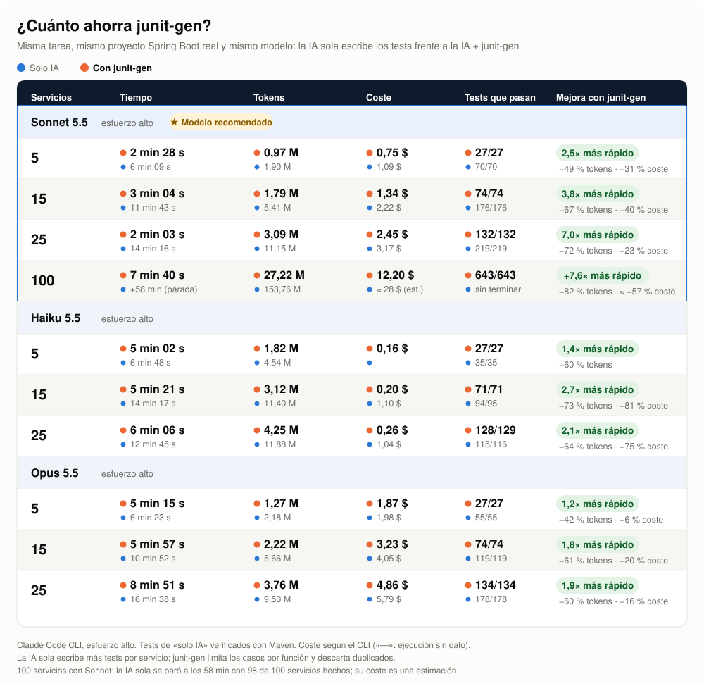

<div align="center">

# 🧪 junit-gen

### Pide los tests con tus palabras. Recíbelos compilados, ejecutados y explicados.

```
/generartest genérame los tests de PedidoService y UsuarioService
```

**La IA decide qué probar. junit-gen se encarga de que funcione.**
Sin tocar ni una línea de tu proyecto.


</div>

---

## ¿Por qué junit-gen?

Pedirle tests a una IA "a pelo" suele acabar igual: tests que no compilan, mocks inventados, imports que no existen y un `assertEquals` cambiado para que pase. Y tú revisando todo a mano. Y además es lento: la IA escribe cada archivo de test palabra a palabra.

### ⚡ Los tests los escribe una aplicación Java, no la IA

junit-gen es una **aplicación Java** que analiza tu proyecto y **genera ella misma el código de los tests**, en milisegundos. La IA solo le dice *qué* probar con unas pocas líneas de JSON; todo el código lo escribe, compila y ejecuta junit-gen.

- 🚀 **Hasta 7,6× más rápido** que si la IA escribiera cada test: la IA genera un spec corto en vez de archivos enteros, y en Claude Code los servicios se reparten entre subagentes que trabajan **en paralelo**.
- 💸 **Gasta mucha menos IA**: entre un 42 % y un 82 % menos de tokens y hasta un 81 % menos de coste en las pruebas medidas (Haiku, Sonnet y Opus 5.5).
- 🎯 **Resultado uniforme y fiable**: mismo estilo en todos los tests, imports y firmas reales sacados de tu código, sin inventos.
- ♻️ **Regenerar no cuesta IA**: a partir del `spec.json` junit-gen vuelve a escribir los tests al instante.

**junit-gen cambia el reparto:**

| La IA (Copilot, Claude…) | junit-gen |
|---|---|
| Elige las funciones importantes de cada servicio | Escanea el proyecto y le da la estructura real de cada clase |
| Propone los casos: escenario, datos, mocks y resultado esperado | Valida, descarta duplicados y escribe los `.java` con una plantilla uniforme |
| Corrige los casos que fallan | Compila y ejecuta cada test en una carpeta temporal y le dice **exactamente** por qué falla |
| — | Arregla solo los fallos mecánicos, sin gastar IA |
| — | Rechaza los "arreglos" que rebajan el test |
| — | Te deja un informe en lenguaje llano |

> La IA **nunca escribe código Java**. Solo rellena un spec JSON. Por eso los tests salen uniformes, compilan y se pueden regenerar sin volver a gastar IA.

### 📊 Medido, no prometido

Mismo proyecto real (Spring Boot, 2 módulos), mismos servicios y tres modelos (Claude Haiku, Sonnet y Opus 5.5, esfuerzo alto, Claude Code CLI). «Solo IA» = pedirle a la IA que escriba, compile y arregle los tests por su cuenta.



Con 25 servicios, la tanda completa tarda **2 min 03 s con Sonnet + junit-gen**, frente a 12–17 min de cualquier modelo trabajando solo. Con **100 servicios** junit-gen terminó en **7 min 40 s** con 643 tests que pasan; Sonnet solo seguía trabajando a los 58 min (98 de 100 servicios) y había gastado más de 5 veces más tokens. En todas las ejecuciones los tests que entrega junit-gen compilan y pasan, y junit-gen no tocó ni un archivo del proyecto; las IAs solas, en cambio, modificaron, apartaron o sobrescribieron tests que ya existían. Con pocos servicios la IA sola escribe más tests por servicio (junit-gen limita los casos por función y descarta duplicados). Los resultados varían entre ejecuciones y dependen del proyecto.

> ### ⭐ Modelo recomendado: **Sonnet 5.5 con esfuerzo alto**
> Es la combinación más rápida y equilibrada: fue la más rápida en todos los tamaños, todos sus tests acabaron pasando y gasta bastante menos que Opus. Haiku es el más barato, pero falla más casos a la primera y la fase de arreglo lo hace más lento; Opus es igual de fiable pero más lento y caro.

---

## 🚀 Qué pasa cuando lo pides

```
/generartest genérame los tests de 25 servicios
```

Tú solo escribes la frase. A partir de ahí todo va solo:

1. **🔍 Lee tu proyecto, sin tocarlo.** junit-gen recorre el código (Maven o Gradle, también multimódulo), localiza los servicios y mira cuáles ya tienen tests. La primera vez te pregunta en qué carpeta guardar los tests nuevos.
2. **📋 Elige los servicios.** Si dices un número, los escoge él; si nombras servicios, usa esos.
3. **👥 Reparte el trabajo.** En Claude Code (y en los planes de pago de Copilot) divide los servicios en bloques y lanza varios **subagentes a la vez**, cada uno con su parte. Si uno termina antes, coge de la **cola** los servicios que nadie ha empezado, así ninguno se queda parado.
4. **🧠 La IA decide qué probar.** En cada servicio elige las funciones con más lógica de negocio y describe los casos en unas pocas líneas de JSON: el caso normal, los errores y los límites, y qué debería pasar en cada uno.
5. **⚙️ junit-gen escribe los tests.** Convierte ese JSON en clases JUnit 5 + Mockito con los imports, firmas y tipos reales de tu código. La IA no escribe ni una línea de Java.
6. **▶️ Los compila y los ejecuta al momento.** En una carpeta temporal aparte y varios servicios a la vez, mientras la IA sigue con el siguiente.
7. **🛠️ Arregla lo que falle, al final.** Primero lo mecánico, sin gastar IA (matchers mezclados, stubs que sobran, imports). El resto vuelve a la IA con el error exacto y pistas concretas. Si el fallo parece un bug real de tu código, no se maquilla: se marca como *posible bug*.
8. **📄 Te entrega el resultado.** Un resumen en el chat, los tests listos para copiar y un `informe.md` en lenguaje llano: qué se probó, por qué, qué falló, qué se arregló y dónde va cada archivo.

| Resultado | Cifra |
|---|---|
| Casos generados | 132 |
| Ejecutados | 132 |
| Pasan | 132 |
| Descartados por duplicado | 2 |
| Arreglados al final | 1 |
| Posibles bugs | 0 |
| Servicios completados | 25 de 25 |

*(Ejecución real: 25 servicios de un proyecto Spring Boot con 2 módulos, Sonnet 5.5 con esfuerzo alto, 2 min 03 s.)*

> **¿Y si es el proyecto entero?** `/generartest todos` hace lo mismo por **oleadas** de 25 servicios: antes de empezar te dice cuánto tardará y costará más o menos, te pide confirmación una sola vez y después encadena las oleadas solo. Si se corta, `/generartest continuar` sigue por donde iba.

> **El último paso es tuyo:** junit-gen nunca copia nada a tu proyecto. Revisas los tests y los copias a `src/test/java` cuando quieras.

---

## 💬 Pídelo como se lo pedirías a un compañero

No hace falta aprender comandos. Escribe `/generartest` y lo que quieres:

| Escribes | junit-gen entiende |
|---|---|
| `/generartest genérame los tests de 10 servicios` | 10 servicios, con sus funciones más importantes |
| `/generartest haz tests de cinco servicios` | 5 servicios (el número vale en cifra o en letra) |
| `/generartest genérame los tests de PedidoService y UsuarioService` | esos dos servicios |
| `/generartest prueba todas las funciones de UsuarioService` | ese servicio, sin dejarse ninguna función |
| `/generartest tests de PedidoService solo de crear y cancelar` | solo esas dos funciones |
| `/generartest continúa la tanda` | sigue donde se quedó |
| `/generartest cambia la carpeta de salida` | te pregunta dónde guardar los tests |

- **Mayúsculas, comillas, comas o la «y»: da igual.** `pedidoservice`, `PedidoService` o `"PedidoService"` son lo mismo.
- **Si escribes una interfaz**, prueba su implementación (`UsuarioService` → `UsuarioServiceImpl`).
- **Si un servicio no existe**, te lo dice y te sugiere los nombres parecidos. Con los que sí existen sigue adelante.
- **Si no queda claro lo que pides** («hazme unos tests»), te pregunta cuántos servicios o cuáles.

> La frase la interpreta **junit-gen**, no la IA. Por eso funciona igual de bien con un modelo potente que con uno más sencillo.

**¿Prefieres ir rápido?** También valen los atajos:

```
/generartest 5                                    → 5 servicios
/generartest PedidoService todas                  → todas sus funciones
/generartest PedidoService funciones=crear,cancelar
/generartest continuar
```

---

## ✨ Qué consigues

- ✅ **Tests que compilan y pasan.** Cada test se compila y se ejecuta antes de dártelo.
- 🛠️ **Arreglo automático al final.** Si falla el test 3 del servicio 23, se apunta, se sigue con el resto y se arregla al final, uno a uno, recompilando.
- 🧠 **Los fallos mecánicos se arreglan sin IA:** matchers mezclados, stubs que no se usan, imports equivocados…
- 🛡️ **Guardia de calidad.** Si la IA intenta quitar una aserción o poner el valor que sale para que pase, junit-gen lo rechaza.
- 🐞 **Detecta posibles bugs.** Si el código no hace lo que debería, el test no se "arregla": se marca como *posible bug* para que lo revises.
- 📄 **Informe para humanos** (`informe.md`): qué se probó, por qué, qué falló, qué se arregló y dónde copiar cada test.
- ♻️ **Sin duplicados y sin pisar nada.** Los tests existentes solo se amplían; nunca se borran.
- 📦 **Tandas grandes.** «genérame los tests de 50 servicios» los hace del tirón; si se corta, «continúa la tanda».
- 🌊 **Todos los servicios, por oleadas.** `/generartest todos` (o «genera tests para todos los servicios») recorre el proyecto entero en oleadas de 25 servicios: primero los que no tienen tests, después los de más lógica. Antes de empezar te da una estimación (servicios, oleadas, tiempo y coste) y pide **una sola** confirmación; `/generartest todos máx 50` limita y no pregunta. Cada oleada es una tanda normal (en paralelo si el cliente tiene subagentes), el progreso se guarda en `oleadas.json` (se retoma con `continuar`) y al final hay un informe global. Variables: `JUNITGEN_OLEADA` (servicios por oleada, 1..100) y `JUNITGEN_TODOS_SIN_CONFIRMAR=1` (sin confirmación; necesario con `claude -p`).
- 🔒 **Solo lectura sobre tu proyecto.** Todo se escribe en una carpeta de salida aparte.

---

## 📂 Qué genera

```
ejemploTest/
├── informe.md            ← el informe en lenguaje llano
├── spec.json             ← los casos (regenerables sin IA)
├── tanda.json            ← progreso, para retomar
├── oleadas.json          ← progreso del modo «todos» (solo si lo usas)
├── perfil-proyecto.json  ← lo que junit-gen aprende de tu proyecto
├── PedidoService/
│   └── PedidoServiceImplTest.java
└── UsuarioService/
    └── UsuarioServiceImplTest.java
```

### Un test generado

Extracto abreviado de `PedidoService/PedidoServiceImplTest.java` del proyecto de ejemplo (el archivo real lleva además la cabecera, los imports y marcadores `// junit-gen:` que permiten ampliarlo sin reescribirlo):

```java
// Copiar a: src/test/java/com/ejemplo/tienda/pedidos/PedidoServiceImplTest.java
@ExtendWith(MockitoExtension.class)
class PedidoServiceImplTest {

    @Mock private PedidoRepository pedidoRepository;
    @Mock private StockClient stockClient;
    @InjectMocks private PedidoServiceImpl service;

    @Test
    @DisplayName("crear: lanza SinStockException si no queda stock del producto")
    void crear_sinStock() {
        // Preparación
        PedidoRequest request = new PedidoRequest(42L, 3);
        when(stockClient.disponible(42L)).thenReturn(0);

        // Ejecución y comprobación
        SinStockException ex = assertThrows(SinStockException.class, () -> service.crear(request));
        assertEquals("Producto 42 sin stock", ex.getMessage());
        verify(pedidoRepository, never()).save(any());
    }
}
```

### El informe

Para cada ejecución, el informe cuenta:

- **Qué funciones se han probado y por qué** las eligió la IA.
- **Qué comprueba cada test**, en una frase.
- **El resultado de cada test**: pasa, posible bug o apartado para revisar.
- **Arreglos al final**: qué fallaba, qué se cambió y en cuántos intentos.
- **Medición de la tanda**: tiempo y llamadas por servicio, para ver dónde se va el tiempo.
- **Dónde copiar cada test** en tu proyecto.

---

## 🔒 Tu proyecto, intacto

junit-gen está diseñado para que puedas lanzarlo sobre cualquier repositorio sin miedo:

- **Nunca crea, modifica ni borra nada dentro del proyecto analizado**: ni código, ni `pom.xml`, ni `target`, ni `.git`.
- **Solo escribe en la carpeta de salida** que elijas, y la rechaza si está dentro del proyecto.
- **No ejecuta `mvn compile`, `mvn test`, `gradle build` ni git.** Compila y prueba en una carpeta temporal propia.
- Hace una **foto del proyecto antes y después** de ejecutar los tests y avisa si algo cambia.
- Copiar los tests a `src/test/java` es **siempre un paso manual tuyo**.
- En Claude Code, el plugin además **impide al agente editar archivos o ejecutar comandos** mientras dura la tanda.

---

## 📦 Instalación

**Requisito:** Java 17 o superior (JDK) en el `PATH`.

**Modelo recomendado:** Sonnet 5.5 con esfuerzo alto (ver [«Medido, no prometido»](#-medido-no-prometido)).

### Claude Code (plugin)

```
/plugin marketplace add Ftejero21/junit-gen
/plugin install junit-gen@junit-gen
```

Abre Claude Code en la carpeta de tu proyecto Java y escribe, por ejemplo, `/generartest genérame los tests de 5 servicios`.

El comando completo es `/junit-gen:generartest`; el corto `/generartest` funciona mientras no haya otro comando con ese nombre.

### GitHub Copilot en VS Code

1. **Instala** (una sola vez): registra el servidor MCP en VS Code y copia la skill `/generartest`.
   ```bash
   git clone https://github.com/Ftejero21/junit-gen.git
   cd junit-gen
   ./instalar-copilot.sh            # Windows: powershell -ExecutionPolicy Bypass -File .\instalar-copilot.ps1
   ```
2. **Reinicia VS Code** y abre tu proyecto (p. ej. `C:\Proyectos\MiProyecto`).
3. En el chat de Copilot: modo **Agent**, un **modelo fijo** (no «Auto»; mejor Claude Sonnet si lo tienes) y, en el selector de herramientas, activa `junit-gen` y acepta sus herramientas.
4. Escribe `/generartest genérame los tests de 5 servicios`. La primera vez te pregunta la carpeta de salida (p. ej. `C:\Proyectos\MiProyectoTest`) y la recuerda.
5. Revisa los tests y el `informe.md` de esa carpeta y copia a `src/test/java` los que quieras.

> **💡 Copilot también trabaja en paralelo, pero Claude Code sigue siendo la mejor opción.** En los planes de pago de Copilot, junit-gen reparte los servicios entre **subagentes** (herramienta `task`) igual que en Claude Code: en una prueba con 5 servicios pasó de 6 min 56 s a 4 min 08 s. Aun así, recomendamos Claude Code porque:
> - **Más seguro:** el plugin **impide al agente editar archivos o ejecutar comandos** mientras dura la tanda; en Copilot depende de que el modelo respete las instrucciones.
> - **Respuestas más completas:** Copilot corta las respuestas largas de las herramientas, así que junit-gen le envía el código en trozos más pequeños y hace falta alguna llamada más.
> - **Medido a fondo:** todas las cifras de la tabla son de Claude Code.
>
> Si tu Copilot no tiene subagentes (plan gratuito), junit-gen trabaja en **modo secuencial**: funciona igual, pero es más lento con muchos servicios; pide los servicios por tramos o retoma con `/generartest continuar` en un chat nuevo.

### Desde el código

```bash
mvn -DskipTests package    # genera target/junit-gen.jar
```

Funciona con cualquier cliente MCP por stdio: `java -jar junit-gen.jar mcp`.

---

## 🧪 Pruébalo con el proyecto de ejemplo

En [`ejemplo/`](ejemplo/) hay una tienda pequeña (Maven, Spring) con 5 servicios y sin tests. Ábrela en Claude Code o en VS Code y escribe:

```
/generartest genérame los tests de 2 servicios
```

Más detalles en [ejemplo/README.md](ejemplo/README.md).

---

## ⚙️ Configuración opcional (`junit-gen.yml`)

```yaml
porcentajeFunciones: 60      # % de funciones con lógica que se prueban por servicio
fallosAsercion: revisarIa    # revisarIa | preguntar
arreglos: alFinal            # alFinal | inmediato
verificacion: siempre        # siempre | preguntar | nunca
verificadores: 4             # pruebas de servicio simultáneas (1..8; por defecto automático)
oleada: 25                   # servicios por oleada del modo «todos» (1..100; por defecto 25)
```

**Velocidad.** El spec que escribe la IA es compacto: omite `version`, `proyecto`, `estilo`, `id`, `claseTest`, `imports`, `parametros` y las listas vacías (junit-gen los completa y deduce el `id` de `metodo` + `escenario`), con `queHaceOriginal` una vez por función y `queComprueba` en cada caso. El escaneo en memoria solo se reutiliza si la huella de las fuentes y de los archivos de build no cambió. Variables de entorno opcionales: `JUNITGEN_PREESCANEO=1` (pre-escaneo en segundo plano al arrancar el servidor MCP; algo de CPU al arrancar), `JUNITGEN_CARGA_DIRECTA=1` (marca las herramientas principales para clientes con carga diferida), `JUNITGEN_VERIFICADORES` (1..8, pruebas de servicio simultáneas) y, en el modo paralelo con subagentes, `JUNITGEN_COLA=0` (desactiva la cola de trabajo entre bloques); ver el [manual](docs/MANUAL.md#modo-paralelo-subagentes).

---

## ❓ Preguntas frecuentes

**¿Tengo que escribir los nombres exactos?**
No hace falta respetar mayúsculas. Si te equivocas en un nombre, junit-gen te sugiere los parecidos.

**¿Qué no entiende todavía?**
«Todos los servicios» sin un número (te pregunta cuántos) y las exclusiones como «menos PedidoService» (las ignora y te avisa).

**¿Qué IA necesito?**
Cualquiera que hable MCP: GitHub Copilot, Claude Code… Cuanto mejor el modelo, menos fallos que arreglar, pero junit-gen pone las mismas garantías con todos.

**¿Y si la IA se equivoca?**
junit-gen compila y ejecuta cada caso. Si falla, le da a la IA el error real y pistas concretas: firmas reales, imports correctos, qué stub sobra… Si tras 3 intentos no se arregla, el caso se aparta: queda comentado en el test y anotado en el informe, nunca se borra.

**¿Me cambia los tests que ya tengo?**
No. junit-gen nunca toca tu proyecto: todo lo que crea va a la carpeta de salida. Tampoco repite los casos que ya tienes. Si ya tienes `PedidoServiceTest.java`, te deja en la salida una versión ampliada con ese mismo nombre: tu archivo tal cual, sin cambiar ni una línea, y los casos nuevos añadidos al final, usando tus propios mocks (también si tu test usa `@SpringBootTest` y `@MockBean`). Antes de dártela comprueba que compila y que tus tests siguen pasando. Tú decides si la copias encima de la tuya. Si no se puede mezclar con seguridad, los casos nuevos van aparte, en `PedidoServiceGeneradoTest.java`, y el informe explica por qué.

**¿Funciona con Spring Boot y con proyectos multimódulo?**
Sí. Maven y Gradle, uno o varios módulos.

---

## 📚 Manual completo

Instalación manual, configuración de cada cliente, el plugin de Claude Code, uso por terminal, formato del spec y todas las opciones: [docs/MANUAL.md](docs/MANUAL.md).

---

## 📄 Licencia

[MIT](LICENSE)
